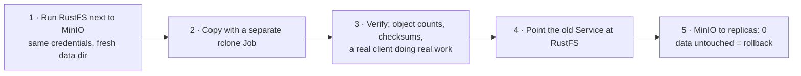

The quick honest take: one morning in November I went to pull a MinIO image and got a 404. Not for one tag, for all of them, on docker.io and quay.io alike, and the `minio/mc` client image was gone too. My cluster runs four MinIO instances. One holds the platform's generated images and media, one is the target for all five nightly restic backups, one serves hn.fm's podcast audio, and one sits quietly inside Milvus. They were all still running, but none of them could be rescheduled, rebuilt, or upgraded. So I moved all four to [RustFS](https://github.com/rustfs/rustfs), an Apache-2.0, S3-compatible object store written in Rust, in one day, and no client noticed. Here's how, and the two things that bit me.

<!-- truncate -->

## Why "it's still running" wasn't good enough

A pod whose image you can't pull is fine until the node reboots, the pod gets evicted, or the kubelet's image garbage collector decides the disk is too full. (That last one happened to me on a different node the same day, so this is not hypothetical.) The backup store worried me most. A backup target I can't rebuild is a single point of failure for every other recovery plan in the house. So "migrate later" really meant "migrate before the next bad reboot."

## The one rule: the name is the contract

Every client in the lab talks to S3 through a Kubernetes Service name and a set of root credentials from a Secret. None of them care what's behind the name. So the plan for each store was the same:

The Services kept their names: `minio`, `minio-backups`, `hnfm-minio`, `milvus-minio`. The Secrets didn't change. Rolling back means pointing a selector at the old pods again and scaling them up.

## Four stores, four slightly different moves

**Platform (a3).** Three buckets (generations, Immich database backups, inference.club media), 152 objects and 1.8 GiB, mirrored with zero differences. MinIO's IAM state doesn't come along with the objects, so I recreated the `generations` user and its two bucket policies by hand. The bootstrap Job that creates them from scratch now uses RustFS's `rc` CLI instead of `mc`, since `mc`'s image is gone too. Placement got one deliberate change. After the [a3 thermal-runaway postmortem](/hardware/nodes) I moved a3's cluster database onto its small SSD, and the rule since then is that bulk blobs live on the HDD. So the new store writes to a hostPath on the HDD instead of a fresh local-path volume, which would have landed on the SSD next to the database.

**Backups (a2).** This is the one I was nervous about. 340 objects, 1.96 GiB of encrypted restic packs. `rclone check` found zero differences. Matching checksums only prove the bytes arrived, though, not that restic can use them. So before switching over I ran a real restic backup, a prune, and a `restic check` against RustFS, and got "no errors". Matching checksums tell you the copy finished. A restic run that succeeds tells you the backups are usable.

**hn.fm (a2).** The media bucket, 1641 objects and 2.2 GiB, copied inside the app's own chart. hn.fm serves its audio through presigned URLs, and presigned URLs have [broken on me before](/media/hnfm), so I tested the bad cases as well as the good one, through the real `hnfm.lan` ingress: a valid link returned 200 `audio/mpeg`, a tampered signature returned 400, and an anonymous request returned 403. An S3-compatible store has to reject requests correctly, not just serve them.

**Milvus (a2).** Its chart bundles its own MinIO, and the chart's escape hatch is `externalS3`. Using it would have put the access keys in plain Helm values in a public repo. So instead a kustomize patch swaps the image and arguments on the chart's bundled Deployment, and the Service, Secret and PVC stay where they were. The bucket was empty, which made this the easy one.

Langfuse uses SeaweedFS, so it wasn't affected.

## The two things that bit me

**1Gi isn't enough during a migration.** The first RustFS pod had a 1Gi memory limit, which seemed generous for a store holding 2 GiB. It was OOM-killed partway through the bulk mirror. Writing thousands of objects to a spinning disk as fast as a copy job can push them needs much more buffer than normal traffic does. 2Gi has been fine since. Size the limit for the migration, not the steady state.

**Don't run the copy inside the server.** The obvious way to copy is to exec into the server pod and run a client there. Don't. The copy tool then shares the server's memory limit, and when the OOM hits, it kills the server and the copy together, leaving a half-written bucket. A separate rclone Job with its own resources keeps the two failures apart, and it can be re-run cleanly.

## What I'd tell you if you run MinIO at home

- Check whether your MinIO image tag still pulls. If it's only cached on a node, you're one eviction away from finding out the hard way.
- Treat the client-facing Service name and credentials as the interface, and the server behind it as an implementation detail. That's why this took a day instead of a week.
- Verify with a real client doing real work (a restic check, a presigned GET), not just object counts.
- Keep the old deployment at zero replicas with its data untouched until you've lived with the new one for a while. Rollback should be a selector change, not a restore.

The details per store are on the [storage](/foundations/storage) and [backups](/platform/backups) pages, and the manifests are [`platform/minio/rustfs.yaml`](https://github.com/briancaffey/home-lab/blob/main/platform/minio/rustfs.yaml) and [`clusters/home/minio-backups/rustfs.yaml`](https://github.com/briancaffey/home-lab/blob/main/clusters/home/minio-backups/rustfs.yaml).
