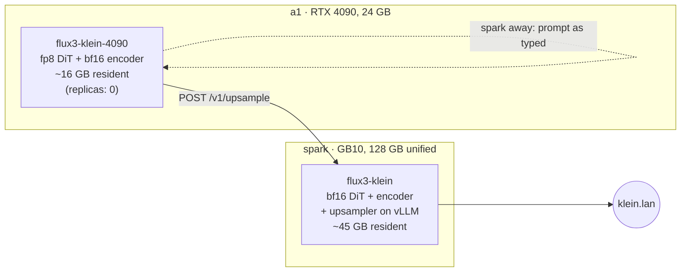

# FLUX 3 Image Klein

**What it is:** [FLUX 3 Image Klein](https://huggingface.co/black-forest-labs/flux-3-image-klein), Black Forest Labs' October 2026 image model, served at `https://klein.lan` by a small FastAPI wrapper around BFL's own reference package. One model does text-to-image, editing against up to ten reference images, and bounding-box layout ("put the mug here, the laptop there"). A **prompt upsampler** sits in front of it, so a short prompt becomes a full scene caption before the image model sees it.

**Why I run it:** one model covers generation, multi-reference edits and layout, and it's the first image model I've run with an official answer to "my prompts are too short." BFL's model card says plainly that the upsampler belongs in front of the model. Klein is a 16-step distilled flow model sampled without classifier-free guidance, which makes it fast per image, but it expects a detailed caption. The upsampler (`flux-3-image-klein-pup`, a 9B Qwen3.5 vision-language model) writes that caption. For edits, it reads the references and the instruction and describes the target image. So the upsampler isn't optional here, and the hard part of placing Klein was fitting it.

{/* screenshot: ai/flux3-klein-upsample-before-after.png — the same short prompt with upsampling off vs on, plus the upsampled caption */}

## What's in the box

- A **5.6B flow-map DiT**, about 11 GB in bf16. The repo also ships a rowwise **fp8** export (6.3 GB, which runs on Ada and newer) and an **NVFP4** one (5.3 GB, Blackwell only).
- A **Qwen3-VL-4B** text encoder, about 9 GB in bf16.
- The autoencoder.
- The **prompt upsampler**, 18.8 GB, served by vLLM inside the same pod.

License: FLUX Kommunity License, which is free under $5M revenue. The repo is gated, and the license is accepted on the Hugging Face account behind the cluster's `hf-token` secret.

## Two placements

**Home: spark.** Everything is resident in unified memory: the bf16 DiT, the encoder, and the upsampler on vLLM (given about 22% of the GB10). That's roughly 45 GB in total, and it [took Qwen-Image's slot](./qwen-image.md), because both models plus LM Studio, acestep and nemotron-asr don't fit together. There's no custom image. The pod reuses the arm64 `vllm/vllm-openai:nightly` image spark already had, which has a recent enough vLLM for Qwen3.5, and pip-installs BFL's package at start, pinned to a commit SHA, through a hostPath pip cache. Manifest: [`services/flux3-klein/flux3-klein.yaml`](https://github.com/briancaffey/home-lab/blob/main/services/flux3-klein/flux3-klein.yaml).

**The 4090 variant: a1.** This is the "does it fit a consumer GPU" answer. The fp8 DiT and the bf16 encoder take about 16 GB, which leaves the rest of the 24 GB card for activations. The 9B upsampler doesn't fit next to them, so this variant runs in `remote` upsampling mode: it sends the prompt to the spark pod's `/v1/upsample` endpoint and renders locally. If spark is offline it falls back to the prompt as typed rather than failing. It ships at `replicas: 0`, because a1's card normally belongs to the speech stack, and running it means parking magpie-tts and studio-voice first. The steps are in the comment at the top of [`services/flux3-klein/a1/`](https://github.com/briancaffey/home-lab/tree/main/services/flux3-klein/a1).

The a1 variant also avoids a1's hard disk entirely. Its weights are a pre-assembled directory on the SSD, verified with sha256, because a1's 6 TB HDD was silently corrupting large writes: three copies of the 6.3 GB fp8 file came out with three different wrong checksums.

:::warning[🔥 War story]
The model does native 4K, so on day one I asked spark for a 4K image, and the whole node wedged. BFL's reference code decodes the entire latent in fp32 in one pass, so decode memory grows with the pixel count. At 8.3 MP that meant tens of GB on top of Klein's 45 GB and everything else living on spark. The GB10's unified memory is also the operating system's memory, so when the decode overran it, the GPU didn't just get an out-of-memory error. The OS ran out of memory too. The fix is a pixel budget in [`server.py`](https://github.com/briancaffey/home-lab/blob/main/services/flux3-klein/server.py): about 4.4 MP per image, which covers the 2K presets and returns a polite 400 above that. The Service also doesn't advertise the `4k` feature, so the inference.club playground never shows 4K presets for this model. The lesson I took: **on unified memory, "the GPU has room" and "the machine has room" are the same question.** Budget for the node's other tenants, not just your own weights.
:::

## Serving

One generation at a time behind an asyncio lock. The upsampler has its own lock, so the 4090 variant can borrow it while spark is rendering. A warm-up render at startup means `/health` only turns green after a real image has come out. The first start can include a ~40 GB download plus vLLM initialization, so the startup probe allows two hours.

| Endpoint | Shape | Who uses it |
|---|---|---|
| `POST /v1/generate` | native JSON: prompt, base64 refs, boxes, size, steps, seed, upsample | me, scripts |
| `POST /v1/upsample` | prompt (+ refs, + boxes) → the caption the DiT will see | the a1 variant |
| `POST /v1/images/generations` | OpenAI images API, plus seed/steps/upsample/boxes | the inference.club agent |
| `POST /v1/images/edits` | OpenAI multipart, `image[]` + `prompt` | same |
| `GET /files/{name}` | a saved PNG | browsing outputs |

The Service carries the same `inference-club.com/type: image` discovery labels as the other image models, and its model annotation lists `prompt-upsampling` and `layout-boxes` as features. Those switch on the matching controls in the inference.club playground, so the agent routes images to it with no code change. On the LAN it's `klein.lan` (Traefik, mkcert cert) with a Homepage tile (`KLN`) in the Inference group. It deploys as the `svc-flux3-klein` Argo CD Application in [`clusters/home/argocd/apps/home-services.yaml`](https://github.com/briancaffey/home-lab/blob/main/clusters/home/argocd/apps/home-services.yaml), with the fleet-wide `ignoreDifferences` on replicas, so I decide which image model is awake.

Manifests: [`services/flux3-klein/`](https://github.com/briancaffey/home-lab/tree/main/services/flux3-klein).
