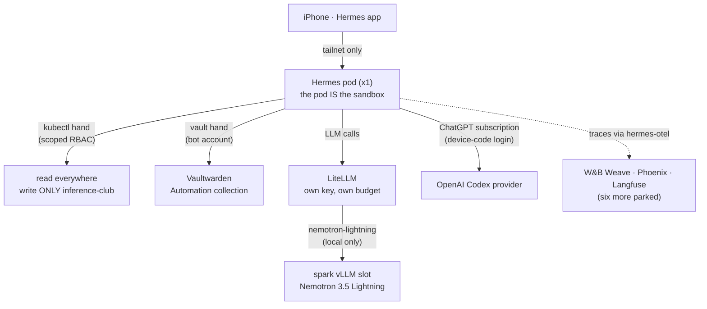

# Hermes: The Agent That Lives Here

**What it is:** [Hermes Agent](https://github.com/NousResearch) (from Nous Research) running *inside* the cluster as a first-class workload — a pod on x1 (the CPU-only ThinkPad node) with a dashboard at `hermes.lan`, an OpenAI-compatible API behind a bearer key, and its entire mind on a persistent volume. Where Claude Code operates the lab *from my laptop*, Hermes is the agent that lives *in* the lab.

**The quick honest take:** a resident agent is only as useful as the places you can reach it from and the brain you can afford to give it. As of November 2026 both of those got better at once: Hermes is on my phone (the iOS app, over the tailnet), and it can think with a local model on spark that is fast enough to not feel like a compromise, or with my ChatGPT subscription when I want a frontier model. The cost was an upgrade that quietly changed where Python dependencies live, which bit the tracing plugin on day one.

**Why I run it:** partly as an experiment in what a resident agent can do, and partly because it genuinely does things — it renders videos headlessly (the hyperframes skill: HTML→video with ffmpeg and Chromium, all in-pod), answers questions about the cluster, and fetches its own credentials when a task needs them. It's also the best possible test subject for the question this whole lab keeps asking: *how much can you safely delegate?*

{/* screenshot: ai/hermes-dashboard.png — the dashboard chat view */}

## The hands (what it's actually allowed to touch)

- **kubectl hand:** a ServiceAccount with cluster-wide *read* and write *only* in the inference namespace — it can park and unpark models, restart a wedged vLLM, and diagnose anything, but it cannot touch the monitoring stack, the databases, or itself.
- **vault hand:** a `vault-secret` command wired to the same Vaultwarden bot account the human tooling uses — with ground rules baked into its skill: never print secret values, prove access by *using* a credential, exact item names only. (The full story is in [The Trust Fabric](../tissue/trust-fabric.md).)
- **Skills:** operate-the-cluster, fetch-secrets, and hyperframes video rendering — the image ships Node, ffmpeg, and headless Chromium, so "make me a video about X" renders entirely in-pod.
- **Traces:** every run is exported through hermes-otel — today to W&B Weave in the cloud plus Phoenix and [Langfuse](../observability/langfuse.md) in-cluster — so "why did it do that?" has a span tree to point at instead of a log scroll. In September it fanned out to every self-hostable backend the plugin supports ([one turn, nine backends](../observability/otel-backends.md)); the other six are parked now, still in the config but commented out.

## The tracing plugin, pinned

hermes-otel is my own plugin, and for a while Hermes ran it from a fork branch that drifted from the releases. Now an init container installs the plugin package from a **pinned release tag** on every boot (1.32.6 as of November 2026), so the version Hermes runs is one line in [`deployment.yaml`](https://github.com/briancaffey/home-lab/blob/main/clusters/home/hermes/deployment.yaml) and a bump is a commit. The plugin's config — the list of backends and which signals each gets — is a ConfigMap mounted into the pod and handed to the plugin via `HERMES_OTEL_CONFIG`, its highest-precedence config path. Edit the file, push, Reloader rolls the pod. The secrets those backends need arrive as environment from `hermes-secrets`, which External Secrets fills from Vaultwarden; the committed config only ever names the variables.

That last sentence exists because of a failure: a seeded copy of the config landed in a directory the 1.x plugin no longer reads, the backends list was silently ignored, and the plugin auto-detected a *cloud* backend from stray environment variables instead. The full story is in the [backends page's war story](../observability/otel-backends.md). It happened again in November, for a different reason; see below.

## Upgrading to v0.23 (where plugin dependencies live now)

In November 2026 I moved Hermes from v2026.7.7 (0.18.1) to **v0.23.0**. Upstream switched to semver image tags along the way, so the version jump looks bigger than it is. I took a restic snapshot of its volume first, because that volume is the agent's whole memory. Three things changed that matter here:

- **OpenTelemetry is in the image now**, on Python 3.14. For months I had an init container that installed the OTel libraries onto the volume and a `PYTHONPATH` override to load them. Both are gone. The old copies were built for Python 3.13 and would have shadowed the bundled ones.
- **`PYTHONPATH` doesn't work anymore anyway.** The v0.23 launcher strips it. Plugin Python dependencies now live in Hermes's own package-manager "dependency generations" on the volume. I ran `hermes pm repair` once, and the image re-resolves them on every upgrade. Hermes owns that job now, which is less for me to maintain.
- **A weak API key is now fatal.** v0.23 refuses to start the API server if `API_SERVER_KEY` is weak. Mine passed, but check yours before you upgrade, not after.

:::warning[🔥 War story]
**The config file nobody read, part two.** Right after the upgrade, traces went to exactly one place: Langfuse, at its *cloud* default address. That is the same symptom as the September war story, with a different cause. The new image didn't ship PyYAML, so the plugin couldn't parse its YAML config. It skipped the file without an error and fell back to auto-detecting backends from environment variables. It found Langfuse keys and pointed them at the cloud.

Two fixes. The real one: PyYAML (and the OTLP gRPC exporter) are declared plugin dependencies, installed through Hermes's dependency generations. The safety net: `LANGFUSE_BASE_URL` is pinned to the in-cluster Langfuse in the deployment, so even if auto-detection ever runs again, it can't leave the house. Then I sent a real agent turn and checked that the trace showed up in Phoenix. A green "export OK" doesn't tell you where the export went.
:::

## Hermes in my pocket

Hermes has an iOS app (in beta), and it's now how I talk to the agent when I'm not at a desk. The detail that cost me a round trip: **the app connects to the Hermes dashboard (port 9119), not the gateway API (8642).** Point it at the API and it says the server is "not the Hermes dashboard (HTTP 404)". It is right, and it doesn't explain anything else.

So the dashboard gets one Tailscale Ingress, [`ingress-hermes.yaml`](https://github.com/briancaffey/home-lab/blob/main/clusters/home/tailscale/ingress-hermes.yaml), served at `https://hermes.<tailnet>.ts.net` with a real Let's Encrypt cert. In the app I choose **Password** sign-in, which is the dashboard's basic auth. The address is tailnet-only and stays that way. The dashboard can start agent runs, and an agent with a kubectl hand and a vault hand is not going on Funnel. One operational note: if you change the backend port on an existing Tailscale Ingress, delete its proxy pod. It doesn't pick up the change by itself.

{/* screenshot: ai/hermes-ios-app.png — the Hermes iOS app connected to the dashboard over the tailnet */}

## Which brain it uses

Hermes can now use two kinds of model, and I switch between them from the app depending on the task:

- **My ChatGPT subscription.** `hermes auth add openai-codex` runs a device-code login: the pod prints a link and a code, and I approve it from any device. That works fine from a headless pod with no browser. It's the frontier option, paid for by a subscription I already have instead of per-token API spend.
- **A local model on spark.** NVIDIA's Nemotron 3.5 Lightning now holds the [spark vLLM slot](./inference-fleet.md), with an 80K context window because Hermes needs more than 64K. It generates about 112 tokens/s and its tool calls parse cleanly. LiteLLM exposes it as `nemotron-lightning`, a **local-only** route with no cloud fallback. If spark is down, asking for it by name returns an error. It never quietly sends the request to a cloud provider.

The old default, NVIDIA's hosted nemotron-3-super, was retired upstream and now returns a 404, so a fresh install needed a new default anyway. I'm not writing down which model is "the default" here. I change it from the app often enough that this page would always be out of date.

## SOUL.md, or: editing a personality with a text editor

Hermes' persona lives in a markdown file called `SOUL.md` on its volume. Edit the file, and the agent's voice changes on its next session. This is either profound or hilarious depending on the hour — and it's genuinely how the upstream project works. I edit it (and the rest of the agent's brain) through [code-server](./code-server.md), a browser VS Code mounted into the same volume.

## Supervision (the honest part)

API-driven agentic runs go through `/v1/runs` with an **approval gate**: tool executions pause until a human (or my own driver script with an allowlist) approves `once`, for the `session`, or `always`. And the security posture is stated plainly: the vault hand can read the whole Automation collection, so **Hermes only ever processes trusted input** — it does not read the open internet into its prompt. If that ever changes, it gets a second, smaller bot account first.

Its brain is backed up nightly by restic like everything else that matters — an agent's accumulated memory turns out to be one of the more irreplaceable things in the house.

Manifests: [`clusters/home/hermes/`](https://github.com/briancaffey/home-lab/tree/main/clusters/home/hermes).
