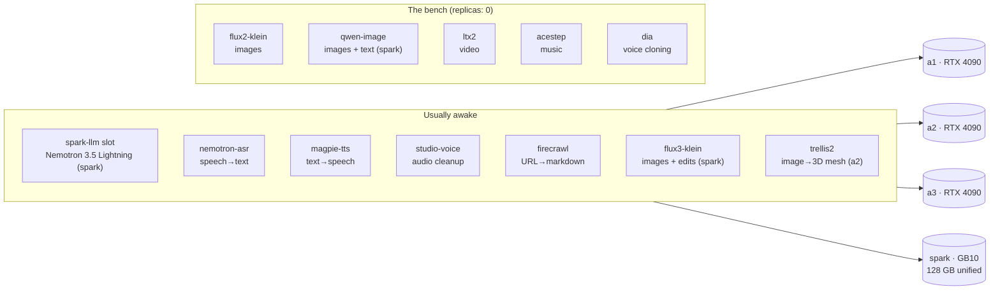

# The Inference Fleet

**What it is:** a namespace called `inference-club` where AI models live as Kubernetes services — a multimodal LLM, speech-to-text, text-to-speech, image generation, video generation, image-to-3D, speech enhancement, web scraping, and a bench of parked experiments. Each one is a container wrapping a model server (most are [vLLM](https://github.com/vllm-project/vllm), some are NVIDIA NIMs or custom servers), and each gets a stable `https://<name>.lan` address with an OpenAPI page at `/docs`.

**Why I run it:** because "call an API" and "own the API" are different hobbies. Running models at home means no per-token bills for experimentation, no rate limits, no data leaving the house — and a forcing function to actually understand GPUs, VRAM, and scheduling. The fleet is the *reason* this cluster exists; everything else on this site is supporting cast.

{/* screenshot: ai/inference-fleet-homepage-tiles.png — the Inference group on home.lan, compact indicator row */}

## The roster

## Daily drivers

- **Chat, reasoning and agent work** from the spark LLM slot, almost always through [LiteLLM](./litellm.md) rather than called directly. Since November 2026 the slot runs NVIDIA's Nemotron 3.5 Lightning, which is also [Hermes](./hermes.md)'s local brain
- **Transcription** via `asr.lan` — audio in, text out, runs on spark's unified memory
- **Voices** from `magpie.lan` — the TTS behind various projects
- **Scraping** with `firecrawl.lan` — URL in, clean markdown out, feeds agents
- **Images and edits** from `klein.lan` — [FLUX 3 Image Klein](./flux3-klein.md): text-to-image, edits from up to ten references, bounding-box layout, and a prompt upsampler in front. It lives on spark (about 45 GB resident). An fp8 variant for a1's 4090 is parked next to it
- **Images with words in them** from `qwen.lan` — [Qwen-Image 2.1](./qwen-image.md), currently parked. Klein took its spark slot because the two don't fit together next to the rest of spark's tenants. Swapping back is two `kubectl scale` commands
- **3D meshes** from `trellis.lan` — [TRELLIS.2](./trellis2.md): one image in, a textured GLB out in about a minute. It moved off spark onto a2's 4090 in November 2026 and claims that card exclusively, taking turns with the host-run LTX-2.5 video server
- **Unparking something** when a project needs it: one `kubectl scale` and a model wakes up

## How it's configured (the interesting parts)

**GPUs are shared deliberately, not automatically.** A pod either claims a whole GPU (`nvidia.com/gpu: 1` — the scheduler enforces exclusivity) or joins the honor system (`NVIDIA_VISIBLE_DEVICES=all` with *no* GPU request — several pods share one card, and the scheduler is blind to it). There's no time-slicing or MPS; a custom `vram-reporter` keeps score out-of-band. One RTX 4090 has 24 GB of VRAM, and I know roughly what every model costs.

**Some models choose their own node.** Most of the fleet fits a 4090 and goes wherever there is VRAM, but Qwen-Image's 33 GB pipeline forced a placement story worth reading on its own: two attempts on a3 (CPU offload, then a 4-bit encoder) each traded away something I wanted, and spark's 128 GB of unified memory was the only honest answer. The details, including the edit that silently did nothing, are on the [Qwen-Image page](./qwen-image.md). Its successor in that slot, [FLUX 3 Image Klein](./flux3-klein.md), also has two placements in git: bf16 on spark, and fp8 on a 4090 that borrows spark's upsampler over the network. And one model is banned from a node outright: [TRELLIS.2](./trellis2.md) panic-rebooted a3, the control plane, on both of its test generations, so it lives on a2 and never on a3.

**spark has exactly one LLM slot.** spark has one GB10, so one vLLM Deployment, `spark-llm`, serves one model at a time. Each model is a small overlay under [`services/vllm/models/`](https://github.com/briancaffey/home-lab/tree/main/services/vllm/models), and [`services/vllm/active/`](https://github.com/briancaffey/home-lab/blob/main/services/vllm/active/kustomization.yaml) points at the one that's loaded. Swapping models means changing that line and pushing. In November 2026 the slot went from Ripple-65B Preview (its overlay is still there) to **Nemotron 3.5 Lightning 30B-A3B in NVFP4**, served with NVIDIA's own DGX Spark recipe on vLLM v0.27.1: Marlin MoE kernels, fp8 KV cache, FlashInfer for the Mamba layers, and a speculative drafter. I measured about 112 tokens/s of generation, tool calls work, and the context window is 80K, since Hermes needs more than 64K. It only claims 30% of spark's memory (`GPU_MEM_UTIL` 0.30). That still leaves far more KV cache than four concurrent sequences need, and the rest of spark's tenants keep their room. The cost is a cold start of about four minutes.

:::warning[🔥 War story]
**spark's WiFi doesn't finish big downloads.** spark is still on WiFi, and multi-gigabyte pulls over it get truncated. During this swap one 4.7 GB image layer was cut off partway and had to be retried. So I don't let the pod fetch anything at startup. The weights, the drafter and the vLLM image are staged on spark *before* the overlay goes active, and the pod starts offline from those local copies. This is the same lesson as a1's flaky USB WiFi: on a wireless node, assume the network will drop and stage files ahead of time.
:::

**Parking is a first-class lifestyle.** I can't run everything at once — video generation alone would eat a whole card — so services scale to zero and back constantly. This shaped two real architectural decisions:

- **GitOps ignores replica counts here.** The Argo CD Applications for `services/*` carry an `ignoreDifferences` rule on `/spec/replicas` — git owns *what* a service is, but *whether it's awake* belongs to me and to Hermes, and no sync ever resets a scale decision.
- **"Parked is not down"** in alerting. Presence alerts are disabled for the fleet; only *behavior* alerts (KV-cache pressure, request backlog, slow first tokens) can fire — and those are computed from live metrics, so a parked service is simply silent. See [Alerting](../observability/alerting.md).

The manifests live in [`services/`](https://github.com/briancaffey/home-lab/tree/main/services) — one directory per model server, plain YAML, each one an Argo Application.
