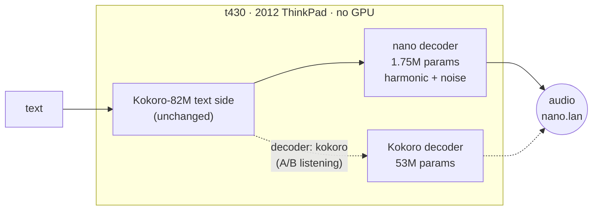

# nano-edge-tts

**What it is:** [drmhse/nano-edge-tts](https://huggingface.co/drmhse/nano-edge-tts), a small text-to-speech model, served at `https://nano.lan` by a FastAPI wrapper. It is [Kokoro-82M](https://huggingface.co/hexgrad/Kokoro-82M) with one part swapped out. Kokoro's text side (the part that turns words into phonemes, timing and pitch) is unchanged. The 53M-parameter decoder that turns all of that into a waveform is replaced by a 1.75M-parameter harmonic-plus-noise decoder. It's Apache-2.0 and English only: 28 US and UK voices. Spanish, French, Hindi, Italian and Portuguese voices load and make sound, but upstream calls them untested, and so do I.

**Why I run it:** the quick honest take is that every other model on this site needs a GPU, and this one runs on the weakest computer I own. It lives on [t430](/hardware/nodes#t430--the-second-laptop-node), a 2012 ThinkPad with an i5-3320M that had no workloads at all before this. On that machine it makes speech about 7 times faster than real time. Stock Kokoro on the same laptop can't keep up with real time. I wanted a voice that is always on, costs no VRAM, and doesn't take 40 minutes to wake up, and this is it.

{/* screenshot: ai/nano-edge-tts-try-it-page.png — the try-it page at nano.lan with a voice picked and the audio player showing */}

## Where it lives

**No GPU, no volume, no network.** The pod has no `runtimeClassName`, no GPU request and no PVC. The decoder weights, the Kokoro weights, the voices and the English G2P model are all baked into the image, pinned to exact upstream revisions, and the decoder file is checksummed at build time. The pod starts offline and is ready about 20 seconds after it's scheduled. Compare that to the GPU services, where a cold start is measured in minutes.

**The image is multi-arch.** `harbor.lan/apps/nano-edge-tts` is built for amd64 and arm64 from the [`Dockerfile`](https://github.com/briancaffey/home-lab/blob/main/services/nano-edge-tts/Dockerfile) in the service directory, with the CPU-only torch wheel so it doesn't drag in 2 GB of CUDA libraries it will never use. It's built off-cluster and pushed to Harbor, and being multi-arch means it could run on spark too. Moving it is a one-line `nodeSelector` change.

**Why t430 and not somewhere faster.** This is the bin-packing goal in its purest form. The model is the only inference service that fits a box without a GPU, so it takes the idlest node in the fleet instead of crowding a 4090 machine. It requests a quarter of a core and 800 MB of RAM, with a 2 GB memory limit.

## How fast is it

RTF (real-time factor) is seconds of compute per second of audio, so lower is faster and anything under 1.0 keeps up with speech. These are my own measurements from [`bench.py`](https://github.com/briancaffey/home-lab/blob/main/services/nano-edge-tts/bench.py), run on the nodes themselves:

| where | decoder | RTF | in plain words |
|-------|---------|-----|----------------|
| t430 (i5-3320M, 2012) | nano | 0.14 | about 7x real time |
| t430 (i5-3320M, 2012) | stock Kokoro | 1.38 | slower than real time |
| a modern desktop-class CPU in the fleet | nano | about 0.015 | about 65x real time |

With sentence-by-sentence streaming, the first audio arrives in about one second on t430, even for a long paragraph.

## How it compares to the other two voices

I run three TTS models now, and they are good at different things. I measured all three on the same day:

| | nano-edge-tts | Magpie | Dia |
|---|---|---|---|
| Hardware | any CPU | GPU, about 12 GB VRAM | GPU |
| Cold start | about 20 s | about 40 min | not measured |
| Speed | 7x real time on a 2012 laptop | about 2x faster per request than nano | slower than real time |
| Languages | English | 12 | not compared |
| Party trick | runs anywhere, starts in seconds | emotion styles | voice cloning and dialogue |

Two accuracy numbers go with that table. For nano-edge-tts I ran an ASR round trip: synthesize the sentences, transcribe the audio with a speech-to-text model, and count the words that came back wrong. It scored 0 word errors out of 147. Dia is built for dialogue and it shows: given short sentences on their own, it failed on 5 of the 12 I tried.

So the split is: Magpie when I need another language, an emotional read or the lowest latency; Dia when I need a cloned voice or a conversation; and nano-edge-tts for plain English narration, long text, and whenever the GPUs are busy or asleep. One caveat: these numbers measure speed and intelligibility, not how natural each voice sounds. The model's author notes a faint machine-like tone on some voices, so listen before choosing.

## Serving

| route | shape | who uses it |
|-------|-------|-------------|
| `POST /v1/audio/synthesize` | Riva-style form fields, same as Magpie | the inference.club agent |
| `GET /v1/audio/list_voices` | Riva-style voice list | the inference.club agent |
| `POST /v1/audio/speech` | OpenAI speech API | anything with an OpenAI client |
| `GET /` | a small try-it page | me, in a browser |
| `GET /health` | readiness check | Kubernetes, Homepage |

A few things the server adds on top of the model:

- **Voice blending.** A voice can be a weighted mix, written like `af_heart:0.7+am_michael:0.3`.
- **Speed** from 0.5x to 2.0x.
- **Output formats:** wav, mp3, opus, flac and raw pcm.
- **Streaming**, one sentence at a time, as wav or pcm.
- **A `decoder: kokoro` switch** that runs the original 53M decoder instead, so I can listen to both on the same text. Keeping it loaded costs about 250 MB of RAM. It's there for A/B listening.

On the LAN it's `nano.lan` (Traefik, mkcert cert), with a Homepage tile and a docs bookmark pointing at `/docs`.

## A second voice in the club

inference.club already had one plain `tts` service, Magpie. nano-edge-tts registers as a second one, with the same `inference-club.com/type: tts` label and the same Riva-shaped paths. That exposed an assumption: with only one `tts` service, the agent never had to choose.

So the agent now routes the Riva tts paths by model, the same way it already routed images. The club backend sends the served model id along with the request (`?model=`), and the agent picks the matching Service. In the club the model id is `nano-edge-tts`. This is live on `club.lan` with the in-cluster agent. The public inference.club site and the public agent haven't changed.

The neat part is that nothing about the model is special-cased. A new Service with the right labels and a model annotation showed up, and the club grew a second voice.

Manifest: [`services/nano-edge-tts/nano-edge-tts.yaml`](https://github.com/briancaffey/home-lab/blob/main/services/nano-edge-tts/nano-edge-tts.yaml). Server: [`server.py`](https://github.com/briancaffey/home-lab/blob/main/services/nano-edge-tts/server.py). Argo Application: `svc-nano-edge-tts` in [`clusters/home/argocd/apps/home-services.yaml`](https://github.com/briancaffey/home-lab/blob/main/clusters/home/argocd/apps/home-services.yaml).
