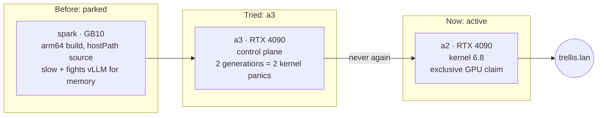

# TRELLIS.2

**What it is:** [TRELLIS.2-4B](https://huggingface.co/microsoft/TRELLIS.2-4B), Microsoft's image-to-3D model, served at `https://trellis.lan` by a small FastAPI wrapper. You give it one picture of an object. About a minute later you get back a textured GLB mesh you can drop into Blender, a game engine, or a browser viewer. It can also render a turntable preview video of the mesh.

**Why I run it:** the quick honest take is that it's the most "how is this possible" model in the fleet. Text and images are things I'm used to models producing. A 3D object with real geometry and baked textures, from a single photo, still surprises me every time. It's also the only `mesh`-type service behind inference.club, so it's the reason the club has a 3D endpoint at all.

{/* screenshot: ai/trellis2-input-and-glb.png — a single input photo next to the generated GLB in a viewer */}

## Where it lives, and why it moved

For months TRELLIS.2 was on the bench, parked on spark. That build was arm64, mounted its source tree from a hostPath, had a performance regression I never tracked down (generations were 10-15x slower than they should have been), and competed with vLLM for spark's unified memory. On 2026-11-08 I gave up on that and moved it to a 4090.

**The image.** It's a new amd64 image built from `Dockerfile.4090` in [briancaffey/Trellis2-DGX-Spark-Docker](https://github.com/briancaffey/Trellis2-DGX-Spark-Docker): torch 2.6 on CUDA 12.4, a prebuilt flash-attn wheel, and TRELLIS's CUDA extensions (nvdiffrast, CuMesh, FlexGEMM, o-voxel) compiled for the 4090's sm_89. Unlike the spark build, the TRELLIS source and the FastAPI wrapper are baked into the image, so nothing depends on a checkout sitting on the node. It's pushed to `harbor.lan/apps` and deployed by the `svc-trellis2` Argo CD Application.

**The weights** come from a2's Hugging Face cache: the TRELLIS.2-4B checkpoint, a decoder borrowed from TRELLIS-image-large, and two gated helper models (a DINOv3 image encoder and RMBG-2.0 for background removal). Any first-time download uses the cluster's `hf-token` secret.

:::warning[🔥 War story]
My first choice was a3, because its 4090 was the least busy. That was a mistake. I ran two test generations, and both of them panic-rebooted the control plane. The trace was the same both times: `kernel BUG at fs/namei.c:934` in `try_to_unlazy`, on Ubuntu's HWE kernel 7.0.0-42. It hit during the generation's burst of compiling and file IO. The first time, the crashing task was netdata reading cgroups. The second time, it was `k3s-server` itself.

The good news is that the [lockup guard](/hardware/nodes#a3--control-plane) from September did its job. Panic-on-oops rebooted a3, and the cluster healed itself in about five minutes each time, with no one touching it. The trap was finding out *why*: the journal had nothing, because the box died before it could flush. The panic traces were sitting in `/var/lib/systemd/pstore`, where the kernel stashes its last words in firmware storage across a reboot. If a node reboots "for no reason", check pstore before you check anything else.

The rule I took away: **no heavy, bursty GPU jobs on the only control plane.** TRELLIS never runs on a3. a2 runs the older 6.8 kernel, and it hasn't flinched.
:::

## How it runs

- **Full bf16, 1024 cascade pipeline.** No quantization, the highest-quality path the model offers.
- **About 50-100 seconds per mesh** once warm. Sampling takes roughly 30-60 s and the texture bake 15-25 s.
- **About 14 GB of peak VRAM**, which is why it claims the whole card (`nvidia.com/gpu: 1`) instead of sharing.
- **Output:** a 17-21 MB GLB with about 300-500k faces. The `preview` format renders a turntable MP4 instead. Getting that to work meant pinning opencv below 5, because opencv 5 can't read the EXR environment map used to light the turntable.

**Host RAM was the second surprise.** The first time I used it from club.lan, a run of back-to-back generations got the pod OOMKilled at its 40 GiB limit, even though every request succeeded. It wasn't a true leak. The server runs each request on a different threadpool thread, and glibc gave each thread its own malloc arena, so the multi-GB mesh and bake buffers fragmented memory that never went back. Resident memory jumped from 15 to 28 GiB on the first request and kept creeping. Setting `MALLOC_ARENA_MAX=2` (plus a trim threshold) holds it flat at about 18 GiB with no change in speed, and the limit is now 32 GiB so a runaway can't crowd a2's other tenants.

**It takes turns with video.** a2's 4090 is also home to the LTX-2.5 video server, which runs on the host outside Kubernetes. The scheduler can't see that process, so the two don't run at the same time. I stop the host's LTX-2.5 service, then scale TRELLIS up, or the other way round. The commands are in the comment at the top of the manifest. Argo CD ignores replica counts for the whole fleet, so a hand scale stays put (see [The Inference Fleet](./inference-fleet.md)).

## Serving

- `GET /health` is the readiness check.
- `POST /v1/3d/generations` is the endpoint inference.club calls: an image in, a GLB (or a turntable preview) out.

The Service carries `inference-club.com/type: mesh` and advertises one model id, `trellis-2`. Both the local-dev inference.club agent and the club.lan agent discover it from those labels, and I've verified `/v1/3d/generations` end to end through the club. On the LAN it's `trellis.lan` (Traefik, mkcert cert), with a Homepage tile labelled "TRELLIS.2 image-to-3D (a2 4090)".

Manifest: [`services/trellis2/trellis2.yaml`](https://github.com/briancaffey/home-lab/blob/main/services/trellis2/trellis2.yaml). Argo Application: `svc-trellis2` in [`clusters/home/argocd/apps/home-services.yaml`](https://github.com/briancaffey/home-lab/blob/main/clusters/home/argocd/apps/home-services.yaml).
