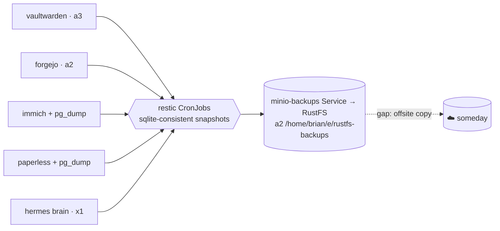

# Backups: An Untested Backup Is a Rumor

**What it is.** A set of nightly [restic](https://restic.net/) jobs that copy everything irreplaceable in the cluster to a dedicated S3-compatible object store on a2's big 5.5 TB disk. Since 2026-11-07 that store is [RustFS](https://github.com/rustfs/rustfs) rather than MinIO (more on that below). Encrypted, deduplicated, retention-managed — and, crucially, **restore-drilled**.

**Why I need it.** My storage philosophy is deliberately boring: node-local disks, no replication. That's only defensible if backups are real. The doctrine here has two lines: *replicate for mobility, back up for safety* — and *an untested backup is a rumor*. The day this system went live, it didn't count as done until a backup had been decrypted, restored, and read back.

**The first principle: only back up what the internet can't restore.**

| Backed up nightly | Deliberately not backed up |
|---|---|
| Vaultwarden's credential DB (03:00) | Container images (Harbor re-pulls them) |
| Forgejo — every repo AND every issue (03:20) | AI model weights (re-downloadable) |
| Immich photos + its Postgres dump (03:40) | Proxy caches |
| Paperless documents + data + Postgres dump (04:00) | Torrent downloads |
| Hermes' brain — SOUL.md, skills, memory (04:20) | Anything an initContainer re-derives |

**How it's wired:**

**Details that earn their keep:**

- **Never share a node with what you protect.** The backup store lives on a2's disk — a *different node and spindle* from Vaultwarden (a3) and Hermes (x1). It's a separate instance from the platform object store on a3, on purpose.
- **SQLite gets consistent snapshots**, not raw file copies — a live WAL database copied naively can be torn. Postgres databases get proper `pg_dump`s with version-matched clients.
- **Retention:** 14 daily + 8 weekly snapshots, pruned in-run, with a 10% read-back integrity check every night.
- **The escrow circularity:** the restic encryption password lives in Vaultwarden *and* the macOS Keychain — because a password stored only inside Vaultwarden can never decrypt Vaultwarden's own backup. Think about that one for a second; it's the kind of trap you only catch by walking the recovery path in your head.

## The store underneath changed, and restic never noticed

In November 2026 upstream MinIO stopped publishing images: every release tag on docker.io and quay.io returned 404, and `minio/mc` disappeared with them. A backup target I can't re-pull is a backup target I can't rebuild, so I moved it to [RustFS](https://github.com/rustfs/rustfs) 1.0.4 (Apache-2.0, S3-compatible, written in Rust). The manifest is [`clusters/home/minio-backups/rustfs.yaml`](https://github.com/briancaffey/home-lab/blob/main/clusters/home/minio-backups/rustfs.yaml).

The trick was to change nothing the clients could see. The Service is still called `minio-backups`, the root credentials and Secret are the same, and the five restic CronJobs were never edited. I ran RustFS next to MinIO on a fresh directory of the same disk, mirrored the restic bucket into it, and only then pointed the Service at the new pods. Before calling it done:

- `rclone check` compared all 340 objects (1.96 GiB) and found 0 differences.
- A real restic backup, a prune, and a `restic check` ran against RustFS and reported "no errors".
- The old MinIO Deployment is still there at `replicas: 0`, with its data directory (`/home/brian/e/backups`) untouched, as the rollback.

:::warning[🔥 War story]
The first RustFS pod had a 1Gi memory limit, which looked generous for a server holding 2 GiB of data. It got OOM-killed in the middle of the bulk mirror: writing a few thousand objects to a spinning HDD as fast as the copy can push them buffers far more than steady-state traffic ever does. 2Gi has been fine. The other lesson from the same afternoon: do the copy from a **separate rclone Job**, not by exec-ing `mc` inside the server pod. A copy tool living in the pod it is writing to fights it for the same memory limit, and an OOM takes out the server and the copy together.
:::

**The restore drill.** A throwaway pod restored Vaultwarden's latest snapshot, decrypted it, and read the database: `integrity_check: ok`, 2 users, 25 ciphers, 1 organization. That moment — not the first successful backup — is when this page earned its title.

**The honest gap:** every snapshot currently lives in the same house as the originals. An offsite copy (a second restic repo on B2/S3 or a friend's box) is the known missing tier, tracked and waiting on a destination decision.
