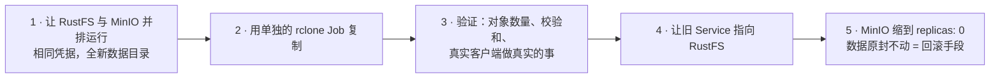

先说句老实话：十一月的一个早上，我去拉一个 MinIO 镜像，拿到的是 404。不是某一个标签，而是全部标签，docker.io 和 quay.io 都一样，连 `minio/mc` 客户端镜像也没了。我的集群里跑着四个 MinIO 实例。一个存着平台生成的图像和媒体，一个是全部五个每晚 restic 备份的目标，一个为 hn.fm 的播客音频提供服务，还有一个安安静静地待在 Milvus 里面。它们都还在运行，但没有一个能被重新调度、重建或升级。于是我用一天时间把四个全部迁到了 [RustFS](https://github.com/rustfs/rustfs)——一个 Apache-2.0 许可、S3 兼容、用 Rust 写成的对象存储——而且没有一个客户端察觉。下面是做法，以及咬了我两口的那两件事。

<!-- truncate -->

## 为什么"它还在跑"不够

一个拉不到镜像的 Pod，在节点重启、Pod 被驱逐、或者 kubelet 的镜像垃圾回收认定磁盘太满之前，都相安无事。（最后那种情况同一天就在另一台节点上发生在我身上，所以这不是假设。）最让我担心的是备份存储。一个无法重建的备份目标，就是家里其他所有恢复计划的单点故障。所以"以后再迁"的真实含义是"在下一次糟糕的重启之前迁完"。

## 唯一的规则：名字就是契约

实验室里每个客户端都通过一个 Kubernetes Service 名字和一个 Secret 里的 root 凭据来访问 S3。它们都不关心名字背后是什么。所以每个存储的计划都一样：

Service 都保留了原名：`minio`、`minio-backups`、`hnfm-minio`、`milvus-minio`。Secret 没变。回滚就是把选择器重新指向旧 Pod，再把它们扩起来。

## 四个存储，四种略有不同的迁法

**平台（a3）。** 三个桶（generations、Immich 数据库备份、inference.club 媒体），152 个对象、1.8 GiB，镜像后差异为零。MinIO 的 IAM 状态不会随对象一起过来，所以我手动重建了 `generations` 用户和它的两条桶策略。从零创建它们的引导 Job 现在用 RustFS 的 `rc` CLI 取代了 `mc`，因为 `mc` 的镜像也没了。放置位置做了一处刻意的改动。在 [a3 热失控事故复盘](/hardware/nodes)之后，我把 a3 的集群数据库挪到了那块小 SSD 上，从那以后的规则是大块数据住在机械盘上。所以新存储写入的是机械盘上的一个 hostPath，而不是新建一个 local-path 卷——那样它会落在 SSD 上、紧挨着数据库。

**备份（a2）。** 这是让我紧张的那一个。340 个对象，1.96 GiB 加密过的 restic 数据包。`rclone check` 发现差异为零。但校验和一致只能证明字节到了，不能证明 restic 能用它们。所以在切换之前，我对 RustFS 跑了一次真实的 restic 备份、一次 prune 和一次 `restic check`，结果是 "no errors"。校验和一致告诉你复制完成了；restic 跑成功才告诉你备份是能用的。

**hn.fm（a2）。** 媒体桶，1641 个对象、2.2 GiB，在应用自己的 chart 里完成复制。hn.fm 通过预签名 URL 提供音频，而预签名 URL [以前就坑过我](/media/hnfm)，所以我通过真实的 `hnfm.lan` ingress，既测了正常情况，也测了异常情况：有效链接返回 200 `audio/mpeg`，签名被篡改返回 400，匿名请求返回 403。一个 S3 兼容存储必须能正确地拒绝请求，而不只是提供服务。

**Milvus（a2）。** 它的 chart 自带一个 MinIO，chart 提供的逃生口是 `externalS3`。用它的话，访问密钥就会以明文出现在公开仓库的 Helm values 里。所以我改用一个 kustomize 补丁，替换 chart 自带 Deployment 的镜像和参数，Service、Secret 和 PVC 都留在原地。那个桶是空的，所以这是最简单的一个。

Langfuse 用的是 SeaweedFS，所以没有受影响。

## 咬了我的两件事

**迁移期间 1Gi 不够。** 第一个 RustFS Pod 的内存上限是 1Gi，对一个只装 2 GiB 的存储来说看似宽裕。它在批量镜像进行到一半时被 OOM 杀掉了。以复制任务能推送的最快速度往机械盘上写几千个对象，需要的缓冲远超正常流量。改成 2Gi 之后一直没事。按迁移时的负载设上限，而不是按稳态。

**别在服务端里面跑复制。** 最直接的复制方式是 exec 进服务端 Pod，在里面跑一个客户端。别这么做。那样复制工具会和服务端共享内存上限，OOM 一来，服务端和复制会被一起杀掉，留下一个写了一半的桶。一个有自己资源配额的单独 rclone Job 能把两种故障隔开，而且可以干净地重跑。

## 如果你在家里跑 MinIO，我想告诉你的

- 检查一下你的 MinIO 镜像标签还能不能拉到。如果它只是缓存在某个节点上，你离用最痛的方式发现这件事只差一次驱逐。
- 把面向客户端的 Service 名字和凭据当作接口，把背后的服务端当作实现细节。这就是为什么这件事花了一天而不是一周。
- 用真实客户端做真实的事来验证（一次 restic check、一次预签名 GET），而不只是数对象。
- 在新部署上稳定运行一段时间之前，让旧部署保持零副本、数据原封不动。回滚应该是改一个选择器，而不是做一次恢复。

每个存储的细节在[存储](/foundations/storage)和[备份](/platform/backups)页面上，清单是 [`platform/minio/rustfs.yaml`](https://github.com/briancaffey/home-lab/blob/main/platform/minio/rustfs.yaml) 和 [`clusters/home/minio-backups/rustfs.yaml`](https://github.com/briancaffey/home-lab/blob/main/clusters/home/minio-backups/rustfs.yaml)。
