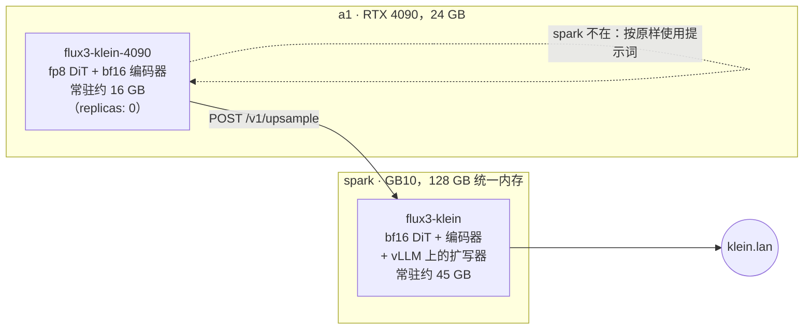

# FLUX 3 Image Klein

**这是什么：** [FLUX 3 Image Klein](https://huggingface.co/black-forest-labs/flux-3-image-klein)，Black Forest Labs 2026 年 10 月发布的图像模型，由一个包着 BFL 官方参考实现的小 FastAPI 服务在 `https://klein.lan` 上提供。一个模型干三件事：文生图、基于最多十张参考图的编辑，以及边界框布局（"杯子放这儿，笔记本电脑放那儿"）。它前面有一个**提示词扩写器**（prompt upsampler），在图像模型看到提示词之前，先把一句简短的提示词扩写成完整的场景描述。

**我为什么要跑它：** 一个模型就涵盖了生成、多参考图编辑和布局，而且它是我跑过的第一个对"我的提示词太短"给出官方答案的模型。BFL 的模型卡写得很直白：扩写器就该放在模型前面。Klein 是一个 16 步、不用无分类器引导（CFG）采样的蒸馏流模型，所以单张图很快，但它期待的是一段详尽的描述。扩写器（`flux-3-image-klein-pup`，一个 9B 的 Qwen3.5 视觉语言模型）负责写这段描述。做编辑时，它会读参考图和指令，然后描述目标图像。所以在这里扩写器不是可选项，安置 Klein 的难点就在于把它也装下。

{/* screenshot: ai/flux3-klein-upsample-before-after.png — the same short prompt with upsampling off vs on, plus the upsampled caption */}

## 盒子里有什么

- 一个 **5.6B 的 flow-map DiT**，bf16 下约 11 GB。仓库里还附带按行量化的 **fp8** 导出（6.3 GB，Ada 及更新架构可用）和 **NVFP4** 导出（5.3 GB，仅限 Blackwell）。
- 一个 **Qwen3-VL-4B** 文本编码器，bf16 下约 9 GB。
- 自编码器（autoencoder）。
- **提示词扩写器**，18.8 GB，由同一个 Pod 里的 vLLM 提供服务。

许可证：FLUX Kommunity License，年收入 500 万美元以下免费。仓库是受限访问的，许可已在集群 `hf-token` 密钥背后的 Hugging Face 账号上接受。

## 两种安置

**家：spark。** 一切都常驻在统一内存里：bf16 DiT、编码器，以及 vLLM 上的扩写器（分到 GB10 约 22% 的内存）。总共大约 45 GB，它[接替了 Qwen-Image 的位置](./qwen-image.md)，因为两个模型再加上 LM Studio、acestep 和 nemotron-asr 放不到一起。没有自定义镜像。Pod 复用了 spark 上已有的 arm64 `vllm/vllm-openai:nightly` 镜像（其 vLLM 版本足够新，支持 Qwen3.5），启动时通过 hostPath pip 缓存安装 BFL 的包，并固定到某个提交 SHA。清单：[`services/flux3-klein/flux3-klein.yaml`](https://github.com/briancaffey/home-lab/blob/main/services/flux3-klein/flux3-klein.yaml)。

**4090 版本：a1。** 这是对"消费级显卡装得下吗"的回答。fp8 DiT 加 bf16 编码器约占 16 GB，24 GB 显卡剩下的部分留给激活值。9B 的扩写器塞不进去，所以这个版本以 `remote` 扩写模式运行：它把提示词发给 spark Pod 的 `/v1/upsample` 端点，然后在本地渲染。如果 spark 离线，它会退回到按原样使用提示词，而不是直接失败。它以 `replicas: 0` 发布，因为 a1 的显卡平时归语音栈所有，要运行它得先停放 magpie-tts 和 studio-voice。具体步骤写在 [`services/flux3-klein/a1/`](https://github.com/briancaffey/home-lab/tree/main/services/flux3-klein/a1) 文件顶部的注释里。

a1 版本还完全绕开了 a1 的机械硬盘。它的权重是 SSD 上一个预先组装好、经过 sha256 校验的目录，因为 a1 那块 6 TB 机械盘一直在悄无声息地损坏大文件写入：那个 6.3 GB 的 fp8 文件复制了三次，得到三个各不相同的错误校验和。

:::warning[🔥 War story]
这个模型原生支持 4K，所以第一天我就让 spark 出一张 4K 图，结果整个节点卡死了。BFL 的参考代码会一次性以 fp32 解码整个潜变量，所以解码内存随像素数增长。在 8.3 MP 下，这意味着在 Klein 的 45 GB 和 spark 上其他所有东西之外，再加几十 GB。GB10 的统一内存同时也是操作系统的内存，所以解码超出上限时，不只是 GPU 报内存不足，操作系统的内存也一起耗尽了。修复是 [`server.py`](https://github.com/briancaffey/home-lab/blob/main/services/flux3-klein/server.py) 里的像素预算：每张图约 4.4 MP，足够覆盖 2K 预设，超过就礼貌地返回 400。Service 也不宣告 `4k` 特性，所以 inference.club 的 playground 永远不会为这个模型显示 4K 预设。我得到的教训：**在统一内存上，"GPU 还有空间"和"机器还有空间"是同一个问题。**要为节点上的其他租户留预算，而不只是算你自己的权重。
:::

## 服务方式

一次只做一张图，背后是一把 asyncio 锁。扩写器有自己单独的锁，所以 spark 在渲染时，4090 版本也能借用它。启动时的一次预热渲染意味着 `/health` 只有在真正产出一张图之后才会变绿。首次启动可能包含约 40 GB 的下载加上 vLLM 初始化，所以启动探针给了两个小时。

| 端点 | 形态 | 谁在用 |
|---|---|---|
| `POST /v1/generate` | 原生 JSON：提示词、base64 参考图、布局框、尺寸、步数、种子、是否扩写 | 我、脚本 |
| `POST /v1/upsample` | 提示词（+ 参考图、+ 布局框）→ DiT 将看到的描述 | a1 版本 |
| `POST /v1/images/generations` | OpenAI 图像 API，外加 seed/steps/upsample/boxes | inference.club 智能体 |
| `POST /v1/images/edits` | OpenAI multipart，`image[]` + `prompt` | 同上 |
| `GET /files/{name}` | 一张保存下来的 PNG | 浏览输出 |

这个 Service 带着和其他图像模型相同的 `inference-club.com/type: image` 发现标签，模型注解里把 `prompt-upsampling` 和 `layout-boxes` 列为特性。它们会打开 inference.club playground 里对应的控件，所以智能体无需改代码就能把图像请求路由过来。在局域网上它是 `klein.lan`（Traefik + mkcert 证书），在 Homepage 的 Inference 分组里有一个磁贴（`KLN`）。它以 `svc-flux3-klein` Argo CD Application 的形式部署在 [`clusters/home/argocd/apps/home-services.yaml`](https://github.com/briancaffey/home-lab/blob/main/clusters/home/argocd/apps/home-services.yaml) 里，带着舰队通用的副本数 `ignoreDifferences`，所以哪个图像模型醒着由我决定。

清单：[`services/flux3-klein/`](https://github.com/briancaffey/home-lab/tree/main/services/flux3-klein)。
