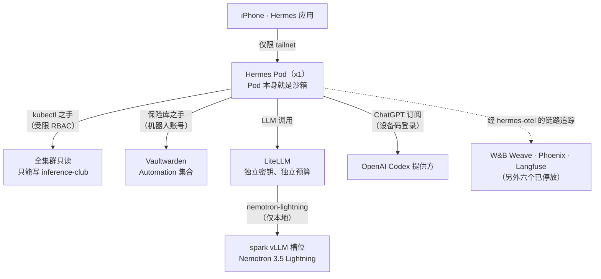

# Hermes：住在这里的智能体

**这是什么：** [Hermes Agent](https://github.com/NousResearch)（来自 Nous Research）以一等公民工作负载的身份跑在集群*内部*——一个位于 x1（纯 CPU 的 ThinkPad 节点）上的 Pod，在 `hermes.lan` 有仪表盘，有一个藏在 bearer key 后面的 OpenAI 兼容 API，整个心智都放在一块持久卷上。如果说 Claude Code 是*从我的笔记本上*操作实验室，那 Hermes 就是*住在*实验室里的那个智能体。

**先说实在话：** 一个常驻智能体有多大用处，取决于你能从哪里够到它，以及你给得起它一颗什么样的大脑。2026 年 11 月，这两点同时变好了：Hermes 上了我的手机（iOS 应用，经由 tailnet），而且它既可以用 spark 上一个快到不像是妥协的本地模型来思考，也可以在我想要前沿模型时用我的 ChatGPT 订阅。代价是一次升级悄悄改变了 Python 依赖的存放位置，第一天就坑了追踪插件。

**我为什么要跑它：** 一半是为了实验"常驻智能体到底能做什么"，一半是因为它真的在干活——它能无头渲染视频（hyperframes 技能：HTML→视频，ffmpeg 加 Chromium，全程在 Pod 里完成）、回答关于集群的问题、任务需要时自己去取凭据。它也是这个实验室一直在追问的那个问题的最佳实验对象：*你能安全地委托多少？*

{/* screenshot: ai/hermes-dashboard.png — the dashboard chat view */}

## 它的手（它实际被允许碰什么）

- **kubectl 之手：** 一个 ServiceAccount，全集群*只读*，写权限*仅限*推理命名空间——它可以停放和唤醒模型、重启卡死的 vLLM、诊断任何问题，但碰不了监控栈、数据库，也碰不了它自己。
- **保险库之手：** 一个 `vault-secret` 命令，接到人类工具链所用的同一个 Vaultwarden 机器人账号上——技能里写死了行为守则：绝不打印秘密值、用*使用*凭据的方式证明访问成功、只用精确条目名。（完整故事在[信任体系](../tissue/trust-fabric.md)。）
- **技能：** 操作集群、取凭据、hyperframes 视频渲染——镜像自带 Node、ffmpeg 和无头 Chromium，所以"给我做个关于 X 的视频"完全在 Pod 内渲染完成。
- **链路追踪：** 每次运行都经 hermes-otel 导出——目前发往云端的 W&B Weave，以及集群内的 Phoenix 和 [Langfuse](../observability/langfuse.md)——所以"它为什么这么做？"有一棵 span 树可以指着看，而不是翻日志。九月时它曾扇出到插件支持的每一个可自托管后端（[一轮对话，九个后端](../observability/otel-backends.md)）；其余六个现在已停放，仍留在配置里，只是被注释掉了。

## 钉住版本的追踪插件

hermes-otel 是我自己的插件，有一段时间 Hermes 跑的是一个和正式发布渐行渐远的 fork 分支。现在一个 init 容器每次启动都从一个**钉住的 release 标签**安装插件包（截至 2026 年 11 月是 1.32.6），所以 Hermes 跑的是哪个版本，就是 [`deployment.yaml`](https://github.com/briancaffey/home-lab/blob/main/clusters/home/hermes/deployment.yaml) 里的一行，升级就是一次提交。插件的配置——后端列表，以及每个后端接收哪些信号——是一个挂载进 Pod 的 ConfigMap，通过 `HERMES_OTEL_CONFIG`（插件优先级最高的配置路径）交给插件。改文件、push，Reloader 滚动 Pod。这些后端需要的密钥以环境变量的形式来自 `hermes-secrets`，由 External Secrets 从 Vaultwarden 填充；提交进 git 的配置只会写变量名。

上面最后那句话之所以存在，是因为一次失败：一份种下的配置副本落在了 1.x 插件不再读取的目录里，后端列表被悄悄忽略，插件反而从散落的环境变量里自动检测出了一个*云端*后端。完整故事在[后端页面的战地故事](../observability/otel-backends.md)里。十一月它又发生了一次，原因不同，见下文。

## 升级到 v0.23（插件依赖现在住在哪里）

2026 年 11 月，我把 Hermes 从 v2026.7.7（0.18.1）升级到了 **v0.23.0**。上游顺便改用了语义化版本的镜像标签，所以版本号的跳跃看起来比实际要大。升级前我先给它的数据卷拍了一个 restic 快照，因为那块卷就是这个智能体的全部记忆。这里有三处要紧的变化：

- **OpenTelemetry 现在打包进了镜像**，跑在 Python 3.14 上。几个月来，我一直用一个 init 容器把 OTel 库装到数据卷上，再用 `PYTHONPATH` 覆盖来加载它们。这两样现在都删掉了。旧的副本是为 Python 3.13 构建的，留着只会遮蔽镜像自带的那份。
- **反正 `PYTHONPATH` 也已经不起作用了。** v0.23 的启动器会把它剥掉。插件的 Python 依赖现在住在 Hermes 自己的包管理器"依赖代"（dependency generations）里，也在数据卷上。我运行了一次 `hermes pm repair`，之后镜像每次升级都会重新解析它们。这件事现在归 Hermes 管，我要维护的东西少了一样。
- **弱 API 密钥现在是致命的。** 如果 `API_SERVER_KEY` 太弱，v0.23 会拒绝启动 API 服务器。我的通过了，但请在升级之前检查你的，而不是之后。

:::warning[🔥 War story]
**没人读的配置文件，第二集。** 升级刚完成时，链路只去了一个地方：Langfuse，而且是它的*云端*默认地址。症状和九月那个战地故事一模一样，原因却不同。新镜像没有带 PyYAML，所以插件解析不了它的 YAML 配置。它没报错就跳过了这个文件，退回到从环境变量自动检测后端。它找到了 Langfuse 的密钥，于是把它们指向了云端。

两处修复。真正的修复：PyYAML（以及 OTLP gRPC 导出器）被声明为插件依赖，通过 Hermes 的依赖代来安装。安全网：在 deployment 里把 `LANGFUSE_BASE_URL` 钉到集群内的 Langfuse，这样即使自动检测哪天又跑起来，也出不了家门。然后我发了一轮真实的智能体对话，确认链路出现在了 Phoenix 里。一个绿色的"导出成功"并不会告诉你导出到了哪里。
:::

## 口袋里的 Hermes

Hermes 有一个 iOS 应用（测试版），现在我不在电脑前时就靠它和智能体对话。让我多跑了一趟的细节：**这个应用连接的是 Hermes 仪表盘（端口 9119），不是网关 API（8642）。** 把它指向 API，它会说这台服务器"不是 Hermes 仪表盘（HTTP 404）"。它说得没错，只是除此之外什么都没解释。

所以仪表盘有了一个 Tailscale Ingress，[`ingress-hermes.yaml`](https://github.com/briancaffey/home-lab/blob/main/clusters/home/tailscale/ingress-hermes.yaml)，地址是 `https://hermes.<tailnet>.ts.net`，带一张真正的 Let's Encrypt 证书。在应用里我选择 **Password**（密码）登录，也就是仪表盘的 basic auth。这个地址仅限 tailnet，也会一直如此。仪表盘能发起智能体任务，而一个手握 kubectl 和保险库的智能体，不会被放上 Funnel。一条运维提示：如果你改了一个现有 Tailscale Ingress 的后端端口，要删掉它的代理 Pod。它不会自己拾取这个变化。

{/* screenshot: ai/hermes-ios-app.png — the Hermes iOS app connected to the dashboard over the tailnet */}

## 它用哪颗大脑

Hermes 现在能用两类模型，我会根据任务在应用里切换：

- **我的 ChatGPT 订阅。** `hermes auth add openai-codex` 会走一次设备码登录：Pod 打印出一个链接和一个验证码，我在任意设备上批准即可。在没有浏览器的无头 Pod 里也完全行得通。这是前沿模型的选项，花的是我本来就有的订阅，而不是按 token 计费的 API 开销。
- **spark 上的本地模型。** NVIDIA 的 Nemotron 3.5 Lightning 现在占据着 [spark 的 vLLM 槽位](./inference-fleet.md)，上下文窗口 80K，因为 Hermes 需要超过 64K。它的生成速度约为每秒 112 个 token，工具调用解析得干干净净。LiteLLM 把它暴露为 `nemotron-lightning`，这是一条**仅限本地**的路由，没有云端降级。如果 spark 宕了，按名字请求它会直接报错，绝不会悄悄把请求发给云端提供方。

旧的默认模型——NVIDIA 托管的 nemotron-3-super——已被上游下线，现在返回 404，所以新装的实例无论如何都需要一个新默认值。我不在这里写哪个模型是"默认"。我在应用里换得够勤，写下来这页就永远是过时的。

## SOUL.md，或者说：用文本编辑器编辑一个性格

Hermes 的人格住在它数据卷上一个叫 `SOUL.md` 的 markdown 文件里。改这个文件，智能体下一个会话的语气就变了。这件事是深刻还是滑稽，取决于你是几点钟想起它——而且这确实就是上游项目的工作方式。我通过 [code-server](./code-server.md)（挂载进同一块卷的浏览器版 VS Code）来编辑它（以及这个智能体大脑的其余部分）。

## 监督（诚实的部分）

由 API 驱动的智能体任务走 `/v1/runs`，带**审批闸门**：工具执行会暂停，直到人类（或者我自己带白名单的驱动脚本）批准 `once`（这一次）、`session`（这个会话）或 `always`（永远）。安全姿态也说得很直白：保险库之手能读整个 Automation 集合，所以 **Hermes 只处理可信输入**——它不会把公开互联网读进自己的提示词。哪天这一点变了，它会先拿到一个第二个、权限更小的机器人账号。

它的大脑和家里其他要紧东西一样，每晚由 restic 备份——事实证明，一个智能体积累下来的记忆，是这屋子里比较难以替代的东西之一。

Manifest：[`clusters/home/hermes/`](https://github.com/briancaffey/home-lab/tree/main/clusters/home/hermes)。
