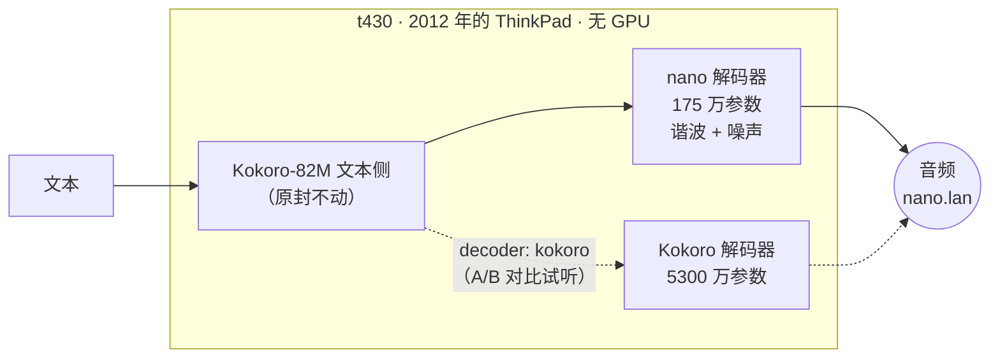

# nano-edge-tts

**这是什么：** [drmhse/nano-edge-tts](https://huggingface.co/drmhse/nano-edge-tts)，一个小型的文字转语音模型，由一个 FastAPI 包装器在 `https://nano.lan` 提供服务。它就是换掉了一个部件的 [Kokoro-82M](https://huggingface.co/hexgrad/Kokoro-82M)。Kokoro 的文本侧（把文字变成音素、时长和音高的那部分）原封不动。把这些变成波形的那个 5300 万参数的解码器，被换成了一个 175 万参数的"谐波加噪声"解码器。许可证是 Apache-2.0，只支持英语：28 个美式和英式音色。西班牙语、法语、印地语、意大利语和葡萄牙语的音色能加载、也能出声，但上游说它们未经测试，我也这么说。

**我为什么要跑它：** 说句实在话，这个网站上其他每个模型都需要 GPU，而这一个跑在我手头最弱的电脑上。它住在 [t430](/hardware/nodes#t430--the-second-laptop-node) 上，一台 2012 年的 ThinkPad，CPU 是 i5-3320M，在此之前一个工作负载都没有。在这台机器上，它生成语音的速度约为实时的 7 倍。同一台笔记本上，原版 Kokoro 连实时都跟不上。我想要一个一直在线、不占 VRAM、也不用花 40 分钟才醒过来的声音，就是它了。

{/* screenshot: ai/nano-edge-tts-try-it-page.png — the try-it page at nano.lan with a voice picked and the audio player showing */}

## 它住在哪里

**没有 GPU，没有卷，不需要网络。** 这个 Pod 没有 `runtimeClassName`，没有 GPU 请求，也没有 PVC。解码器权重、Kokoro 权重、音色和英语 G2P 模型全都打包在镜像里，固定到上游的确切版本，解码器文件还会在构建时校验哈希。Pod 离线启动，被调度后大约 20 秒就绪。对比一下那些 GPU 服务，它们的冷启动是按分钟算的。

**镜像是多架构的。** `harbor.lan/apps/nano-edge-tts` 由服务目录里的 [`Dockerfile`](https://github.com/briancaffey/home-lab/blob/main/services/nano-edge-tts/Dockerfile) 构建，同时支持 amd64 和 arm64，用的是纯 CPU 的 torch wheel，免得拖进来 2 GB 它永远用不上的 CUDA 库。它在集群外构建后推送到 Harbor；多架构意味着它也能跑在 spark 上。搬家只需要改一行 `nodeSelector`。

**为什么是 t430，而不是更快的机器。** 这是"装箱"目标最纯粹的体现。这个模型是唯一一个放得进无 GPU 机器的推理服务，所以它占的是舰队里最闲的节点，而不是去挤一台 4090 机器。它请求四分之一个核和 800 MB 内存，内存上限是 2 GB。

## 它有多快

RTF（实时率）是每秒音频所需的计算秒数，所以越低越快，低于 1.0 就跟得上说话的速度。下面是我自己用 [`bench.py`](https://github.com/briancaffey/home-lab/blob/main/services/nano-edge-tts/bench.py) 在节点本机上测出来的：

| 在哪里 | 解码器 | RTF | 大白话 |
|--------|--------|-----|--------|
| t430（i5-3320M，2012 年） | nano | 0.14 | 约 7 倍实时 |
| t430（i5-3320M，2012 年） | 原版 Kokoro | 1.38 | 比实时还慢 |
| 舰队里一颗现代的桌面级 CPU | nano | 约 0.015 | 约 65 倍实时 |

配合逐句流式输出，即使是很长的一段话，在 t430 上大约一秒就能听到第一段音频。

## 和另外两个声音比起来怎么样

我现在跑着三个 TTS 模型，它们各有所长。三个都是我在同一天测的：

| | nano-edge-tts | Magpie | Dia |
|---|---|---|---|
| 硬件 | 任意 CPU | GPU，约 12 GB VRAM | GPU |
| 冷启动 | 约 20 秒 | 约 40 分钟 | 没测 |
| 速度 | 在 2012 年的笔记本上 7 倍实时 | 单次请求比 nano 快约 2 倍 | 比实时还慢 |
| 语言 | 英语 | 12 种 | 没比较 |
| 拿手好戏 | 哪儿都能跑，几秒就启动 | 情感风格 | 声音克隆和对话 |

这张表还配着两个准确度数字。对 nano-edge-tts，我做了一次 ASR 往返测试：先合成句子，再用语音转文字模型把音频转录回来，数一数有多少词错了。结果是 147 个词里 0 个错误。Dia 是为对话而生的，这一点看得出来：把短句单独拿给它，我试的 12 句里有 5 句失败了。

所以分工是：需要别的语言、带情感的朗读或最低延迟的时候用 Magpie；需要克隆声音或一段对话的时候用 Dia；普通的英文旁白、长文本，以及 GPU 正忙或没开机的时候用 nano-edge-tts。有一点要说明：这些数字衡量的是速度和可懂度，不是声音听起来有多自然。模型作者提到某些音色带有轻微的机器感，所以选之前先听一听。

## 对外服务

| 路由 | 形态 | 谁在用 |
|------|------|--------|
| `POST /v1/audio/synthesize` | Riva 风格的表单字段，和 Magpie 一样 | inference.club 的 agent |
| `GET /v1/audio/list_voices` | Riva 风格的音色列表 | inference.club 的 agent |
| `POST /v1/audio/speech` | OpenAI 语音 API | 任何带 OpenAI 客户端的东西 |
| `GET /` | 一个小小的试用页面 | 我，在浏览器里 |
| `GET /health` | 就绪检查 | Kubernetes、Homepage |

服务器在模型之上还加了几样东西：

- **音色混合。** 一个音色可以是加权混合，写法像 `af_heart:0.7+am_michael:0.3`。
- **语速**从 0.5 倍到 2.0 倍。
- **输出格式：** wav、mp3、opus、flac 和原始 pcm。
- **流式输出**，一次一句，格式为 wav 或 pcm。
- **一个 `decoder: kokoro` 开关**，改用原来那个 5300 万参数的解码器，这样我可以拿同一段文字听两种效果。让它常驻要多花大约 250 MB 内存。它就是为 A/B 对比试听准备的。

在局域网上它是 `nano.lan`（Traefik，mkcert 证书），有一个 Homepage 磁贴，还有一个指向 `/docs` 的文档书签。

## 俱乐部里的第二个声音

inference.club 原本只有一个普通的 `tts` 服务，就是 Magpie。nano-edge-tts 注册成了第二个，带着同样的 `inference-club.com/type: tts` 标签和同样的 Riva 形态路径。这暴露了一个假设：只有一个 `tts` 服务的时候，agent 从来不需要做选择。

所以 agent 现在按模型来路由 Riva 的 tts 路径，和它原本路由图像的方式一样。俱乐部后端会在请求里带上所服务的模型 id（`?model=`），agent 再挑出对应的 Service。在俱乐部里，这个模型的 id 是 `nano-edge-tts`。这已经在 `club.lan` 上配合集群内的 agent 上线了。公开的 inference.club 网站和公开的 agent 都没有改动。

妙处在于，这个模型没有任何特殊处理。一个带着正确标签和模型注解的新 Service 出现了，俱乐部就多了第二个声音。

Manifest：[`services/nano-edge-tts/nano-edge-tts.yaml`](https://github.com/briancaffey/home-lab/blob/main/services/nano-edge-tts/nano-edge-tts.yaml)。服务器：[`server.py`](https://github.com/briancaffey/home-lab/blob/main/services/nano-edge-tts/server.py)。Argo Application：`svc-nano-edge-tts`，位于 [`clusters/home/argocd/apps/home-services.yaml`](https://github.com/briancaffey/home-lab/blob/main/clusters/home/argocd/apps/home-services.yaml)。
