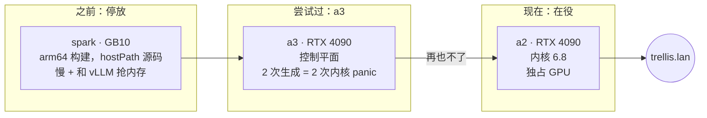

# TRELLIS.2

**这是什么：** [TRELLIS.2-4B](https://huggingface.co/microsoft/TRELLIS.2-4B)，微软的图生 3D 模型，由一个小小的 FastAPI 包装层在 `https://trellis.lan` 提供服务。你给它一张物体的照片，大约一分钟后它还给你一个带贴图的 GLB 网格，可以直接丢进 Blender、游戏引擎或者浏览器里的查看器。它还能为网格渲染一段转台预览视频。

**我为什么要跑它：** 先说句老实话，它是整个舰队里最让我觉得"这怎么可能"的模型。模型生成文字和图片，我早就习惯了；但从一张照片生成一个有真实几何结构、贴图也烘焙好的 3D 物体，每次都还是会让我吃惊。它也是 inference.club 背后唯一一个 `mesh` 类型的服务，所以俱乐部之所以有 3D 接口，全靠它。

{/* screenshot: ai/trellis2-input-and-glb.png — a single input photo next to the generated GLB in a viewer */}

## 它住在哪里，以及为什么搬家

好几个月里，TRELLIS.2 一直坐在替补席上，停放在 spark 上。那个版本是 arm64 构建，源码树通过 hostPath 挂载进去，有一个我始终没查清的性能退化（生成速度比应有的慢 10-15 倍），还要和 vLLM 抢 spark 的统一内存。2026-11-08 我放弃了那条路，把它搬到了一块 4090 上。

**镜像。** 这是一个新的 amd64 镜像，用 [briancaffey/Trellis2-DGX-Spark-Docker](https://github.com/briancaffey/Trellis2-DGX-Spark-Docker) 里的 `Dockerfile.4090` 构建：CUDA 12.4 上的 torch 2.6、一个预编译的 flash-attn wheel，以及为 4090 的 sm_89 编译好的 TRELLIS CUDA 扩展（nvdiffrast、CuMesh、FlexGEMM、o-voxel）。和 spark 版本不同，TRELLIS 源码和 FastAPI 包装层都直接烤进了镜像，不再依赖节点上放着的某个代码检出。镜像推送到 `harbor.lan/apps`，由 Argo CD 的 `svc-trellis2` Application 部署。

**权重**来自 a2 的 Hugging Face 缓存：TRELLIS.2-4B 检查点、一个从 TRELLIS-image-large 借来的解码器，以及两个需要申请访问的辅助模型（一个 DINOv3 图像编码器，和用于去背景的 RMBG-2.0）。首次下载会用集群的 `hf-token` secret。

:::warning[🔥 War story]
我的第一选择是 a3，因为它那块 4090 最闲。这是个错误。我跑了两次测试生成，两次都让控制平面 panic 重启了。两次的内核栈一模一样：Ubuntu HWE 内核 7.0.0-42 上，`try_to_unlazy` 里的 `kernel BUG at fs/namei.c:934`。它发生在生成过程中那一阵密集的编译和文件 IO 期间。第一次崩溃的任务是 netdata 在读 cgroups，第二次则是 `k3s-server` 本身。

好消息是，九月装上的[锁死守护](/hardware/nodes#a3--control-plane)尽到了职责。panic-on-oops 让 a3 自动重启，集群每次都在大约五分钟内自愈，全程没人插手。难点在于查清*原因*：journal 里什么都没有，因为机器在来得及落盘之前就挂了。panic 的内核栈躺在 `/var/lib/systemd/pstore` 里——内核会把临终遗言存进固件存储，跨重启保留下来。如果某台节点"莫名其妙"重启了，先看 pstore，再看别的。

我得到的规矩：**不要在唯一的控制平面上跑又重又突发的 GPU 任务。** TRELLIS 永远不上 a3。a2 跑的是较老的 6.8 内核，至今纹丝不动。
:::

## 运行方式

- **全 bf16，1024 级联流水线。** 不做量化，用的是模型能提供的最高质量路径。
- **预热后每个网格大约 50-100 秒。** 采样大约 30-60 秒，贴图烘焙 15-25 秒。
- **峰值 VRAM 约 14 GB**，所以它独占整块卡（`nvidia.com/gpu: 1`），而不是和别人共享。
- **输出：** 一个 17-21 MB、大约 30-50 万个面的 GLB。`preview` 格式则改为渲染一段转台 MP4。要让它跑起来，得把 opencv 钉在 5 以下，因为 opencv 5 读不了给转台打光用的 EXR 环境贴图。

**宿主机内存是第二个意外。** 第一次从 club.lan 使用时，连续几次生成让 Pod 在 40 GiB 的上限处被 OOMKill，尽管每个请求都成功了。这不是真正的内存泄漏：服务器把每个请求放在线程池里不同的线程上运行，glibc 给每个线程分配了各自的 malloc arena，于是动辄数 GB 的网格和烘焙缓冲区把内存弄得支离破碎，再也还不回去。常驻内存在第一个请求后就从 15 GiB 跳到 28 GiB，之后还在缓慢上涨。设置 `MALLOC_ARENA_MAX=2`（外加一个 trim 阈值）之后，它稳定在约 18 GiB，速度毫无变化；上限也调成了 32 GiB，免得失控时挤占 a2 上的其他租户。

**它和视频轮流上岗。** a2 的 4090 同时也是 LTX-2.5 视频服务器的家，那个服务器跑在宿主机上、在 Kubernetes 之外。调度器看不见那个进程，所以两者不会同时运行。我先停掉宿主机上的 LTX-2.5 服务，再把 TRELLIS 扩起来，反之亦然。具体命令写在 manifest 顶部的注释里。Argo CD 对整个舰队都忽略副本数，所以手动扩缩容会一直保持（见[推理服务舰队](./inference-fleet.md)）。

## 服务接口

- `GET /health` 是就绪检查。
- `POST /v1/3d/generations` 是 inference.club 调用的接口：一张图进，一个 GLB（或一段转台预览）出。

Service 带着 `inference-club.com/type: mesh` 标签，并声明了一个模型 id：`trellis-2`。本地开发的 inference.club agent 和 club.lan 的 agent 都通过这些标签发现了它，我也已经经由俱乐部端到端验证过 `/v1/3d/generations`。在局域网里它是 `trellis.lan`（Traefik，mkcert 证书），Homepage 上有一个标着 "TRELLIS.2 image-to-3D (a2 4090)" 的磁贴。

Manifest：[`services/trellis2/trellis2.yaml`](https://github.com/briancaffey/home-lab/blob/main/services/trellis2/trellis2.yaml)。Argo Application：[`clusters/home/argocd/apps/home-services.yaml`](https://github.com/briancaffey/home-lab/blob/main/clusters/home/argocd/apps/home-services.yaml) 里的 `svc-trellis2`。
