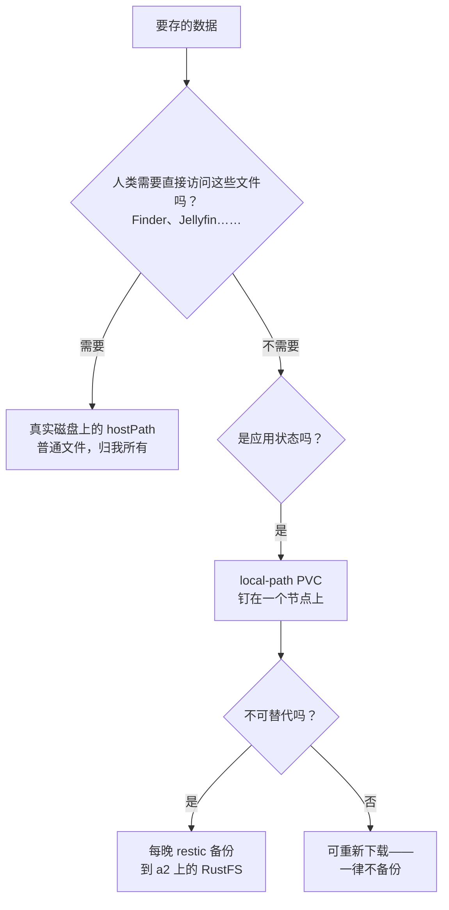

# 存储哲学：刻意的无聊

**它是什么：**这个集群里几乎所有数据，都存在运行它的那台机器的普通本地磁盘上。没有分布式文件系统，没有存储集群，没有魔法。一条信条把一切串起来：**复制是为了可移动性，备份才是为了安全——而没验证过的备份只是一个传闻。**

**为什么我建议从这里起步：**分布式存储是家庭实验室里最诱人的过度工程陷阱。它承诺任何 Pod 都能跑在任何地方，实际交付的是第二份全职工作。本地磁盘加*验证过的每晚备份*就能覆盖真正的风险（丢数据），却不用交运维税——将来你随时可以在真正值得的地方，深思熟虑地引入复制。

## 决策树

**local-path** 是默认的 StorageClass：一个 PVC 就是 Pod 首次落地那个节点上的一个目录，从此这个 Pod 就永远钉在那个节点上。这就是代价——没有可移动性、没有冗余——但它对家庭实验室真正的需求很诚实：数据*存在*，便宜而简单。

**给"人类文件"用 hostPath** 是被低估的一招。种子下载落在 `a2:~/e/downloads`，是归我所有的普通文件——在 Mac 上通过 Samba 像普通文件夹一样浏览，只读挂载进 Jellyfin，任何没听说过 Kubernetes 的工具都能直接用。经验法则：*应用状态用 PVC，人类要碰的文件用普通目录。*把家庭照片库埋进 `/var/lib/rancher/.../pvc-3f9a…` 对谁都没有好处。

**备份是安全层，复制不是。**所有不可替代的东西——密码保险库、Git 托管平台、照片、文档、AI 智能体的记忆——每晚由 [restic](https://restic.net) 备份到 a2 大硬盘上的专用 S3 存储（RustFS），有保留策略、有完整性抽查回读，以及（最关键的）一次**真正执行过的恢复演练**：解密、恢复、打开数据库、数出行数。可重新下载的东西——容器镜像、模型、可以重抓的媒体——*一律*刻意不备份。完整故事在[备份页面](/platform/backups)。

## 对象存储：四个小 S3 存储，如今是 RustFS

有些应用要的是 S3 而不是文件系统，所以实验室里跑着四个小对象存储，各自挨着使用它的东西：a3 上的**平台**存储（图像生成结果、Immich 数据库备份、inference.club 媒体），a2 上 restic 写入的**备份**存储，a2 上 **hn.fm** 的媒体桶，以及 a2 上随 **Milvus** 捆绑的那一个。它们以前全是 MinIO。2026-11-07 它们全部换成了 [RustFS](https://github.com/rustfs/rustfs)，因为上游 MinIO 不再发布镜像，而拉不到的东西我就跑不了。

让这次替换变得轻松的规则是：**面向客户端的名字是契约，背后的服务端不是。**每个 Service 都保留了旧名字（`minio`、`minio-backups`、`hnfm-minio`、`milvus-minio`），每个客户端都沿用旧凭据，所以没有任何应用被改动。旧的 MinIO Deployment 停在零副本，数据完好，以备回滚。验证过程见[备份页面](/platform/backups)。

在 a3 上，[热失控事故复盘](/hardware/nodes)里的一条放置规则同样适用：**大块数据绝不放在承载集群数据库的那块 SSD 上。**平台 RustFS 写入 a3 机械盘上的一个 hostPath（在 k3s 数据目录的 `storage.hdd/` 下），而不是新建一个 local-path 卷——那样它会落在 228 GB 的 SSD 上。清单：[`platform/minio/rustfs.yaml`](https://github.com/briancaffey/home-lab/blob/main/platform/minio/rustfs.yaml)。

## Longhorn 的试水

家里*确实*有一个做了复制的卷。[Longhorn](https://longhorn.io) 只跑在两个节点上（a2 + a3），把副本放在它们的大机械盘上——绝不占用根分区——这是一次刻意的学习练习，先练手，再考虑托付任何珍贵的东西。

## 和它相处的日常

- 新服务？local-path PVC，两行搞定——钉在哪个节点写在 manifest 里
- 任何开始持有不可替代数据的服务，当天就配上 restic CronJob
- 磁盘健康被持续盯着（[Scrutiny](/observability/scrutiny)——12 块盘，SMART 告警直达手机），因为在节点本地存储的世界里，*一块正在死去的磁盘就是事故本身*
